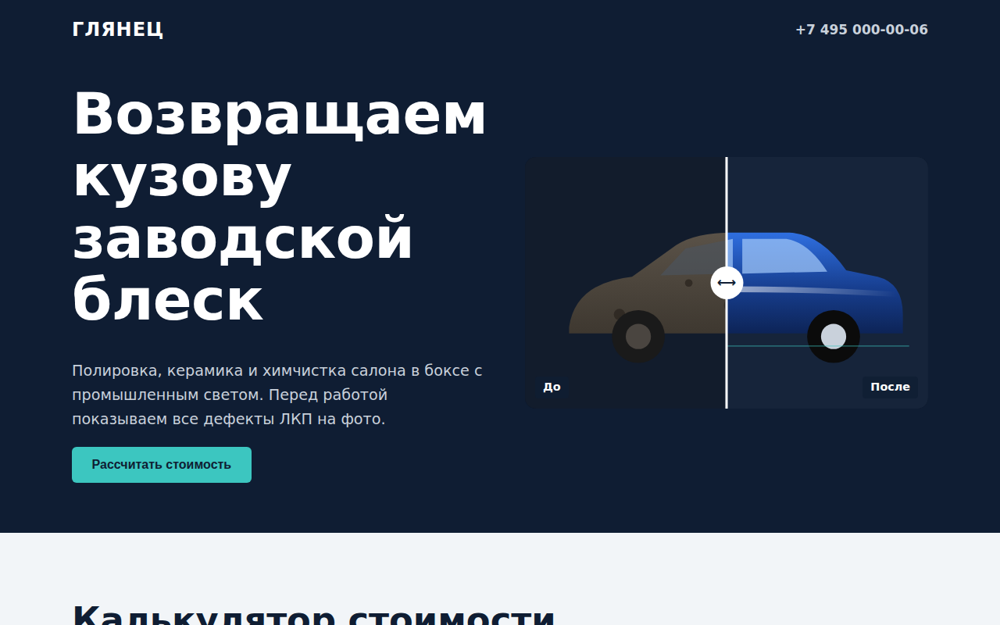

# Глянец: детейлинг-центр

Лендинг детейлинг-центра со слайдером «до и после» и калькулятором стоимости работ. Заявка автоматически подтягивает выбранные в калькуляторе услуги и сумму.



## Возможности

**Слайдер «до и после»**
- Две SVG-иллюстрации машины: грязная и после полировки с бликом
- Ручка сравнения двигается мышью, пальцем и стрелками с клавиатуры

**Калькулятор**
- Класс автомобиля: седан или хэтчбек, кроссовер, внедорожник; класс меняет цены всех услуг
- Шесть услуг: мойка, полировка, керамика, химчистка салона, уход за кожей, плёнка
- Итог и время работ считаются сразу: «заберёте в тот же день» или число рабочих дней
- Список выбранных услуг и подсказка о скидке на комплекс от трёх услуг

**Запись**
- Имя, телефон с маской, марка и модель, дата (не раньше сегодня)
- Проверка имени и телефона с переводом фокуса на ошибочное поле
- Подтверждение с перечнем работ и предварительной суммой

## Стек

HTML5, CSS3 (`clip-path`, custom properties), JavaScript без библиотек, inline SVG, шрифт Exo 2 из Google Fonts.

## Как запустить

Сборка не нужна: откройте `index.html` в браузере.

Или через локальный сервер:

```bash
python -m http.server 8000
# затем http://localhost:8000
```

## Настройка

- Услуги: массив `SERVICES` в скрипте `index.html` (`[id, название, описание, базовая цена, часы, отмечена по умолчанию]`)
- Коэффициенты классов машин: атрибуты `value` у радиокнопок `cls` в разметке (1, 1,2, 1,45)

## Структура проекта

```
index.html    # вёрстка, стили и скрипт в одном файле
```

## Как это устроено

- Слайдер это прозрачный `<input type="range">` поверх двух SVG: значение пишется в CSS-переменную `--pos`, а верхний слой обрезается через `clip-path: inset(0 0 0 var(--pos))`. Поэтому сенсор, мышь и клавиатура работают без своих обработчиков жестов
- Цены округляются до 100 ₽, время до готовности сравнивается с 9-часовым рабочим днём
- Чекбоксы и радиокнопки визуально скрыты, но остаются в форме: состояние берётся из `:checked`, фокус виден через `:focus-visible`
- `prefers-reduced-motion` отключает плавную прокрутку, до 860 px калькулятор в одну колонку, до 540 px форма и классы машин тоже

## Идеи для развития

- Применять скидку на комплекс прямо в итоге
- Выбор времени записи, а не только даты
- Галерея реальных работ

## Лицензия

Концепт-сайт, реального бизнеса за ним нет.

MIT © 2026 whysafe. Telegram: [@yawhysafe](https://t.me/yawhysafe) · Сайт: [whysafe.ru](https://whysafe.ru)
